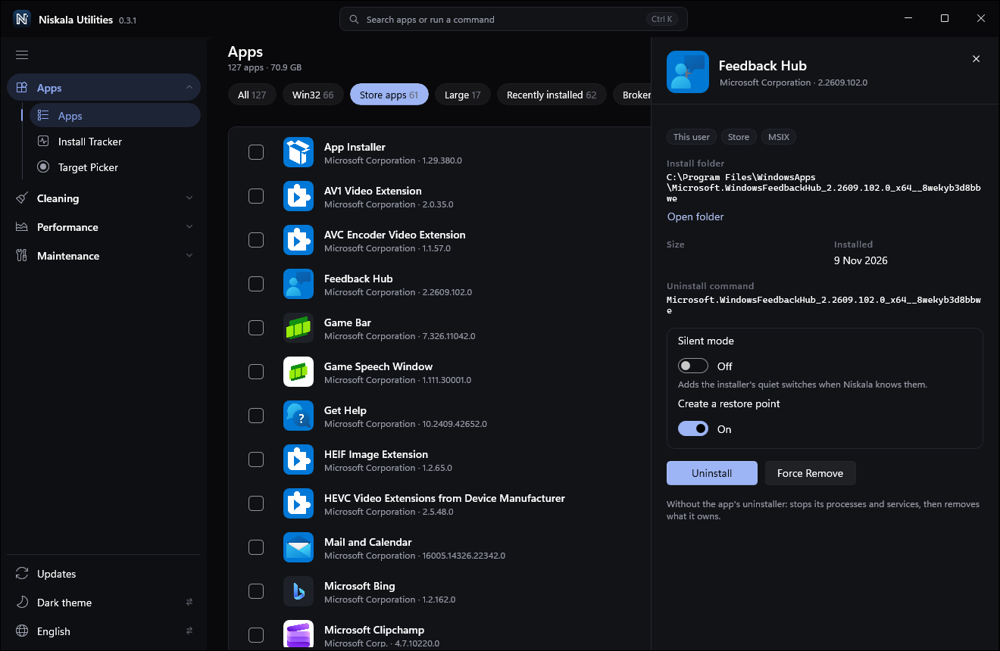
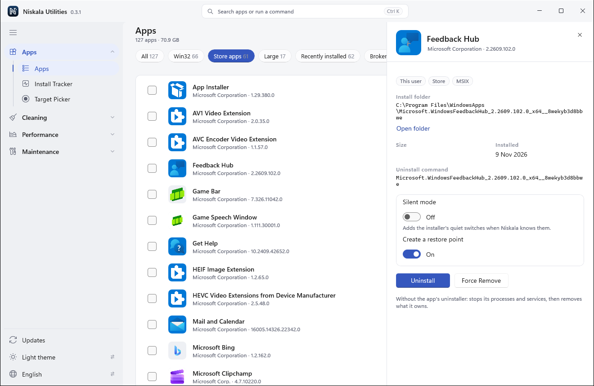
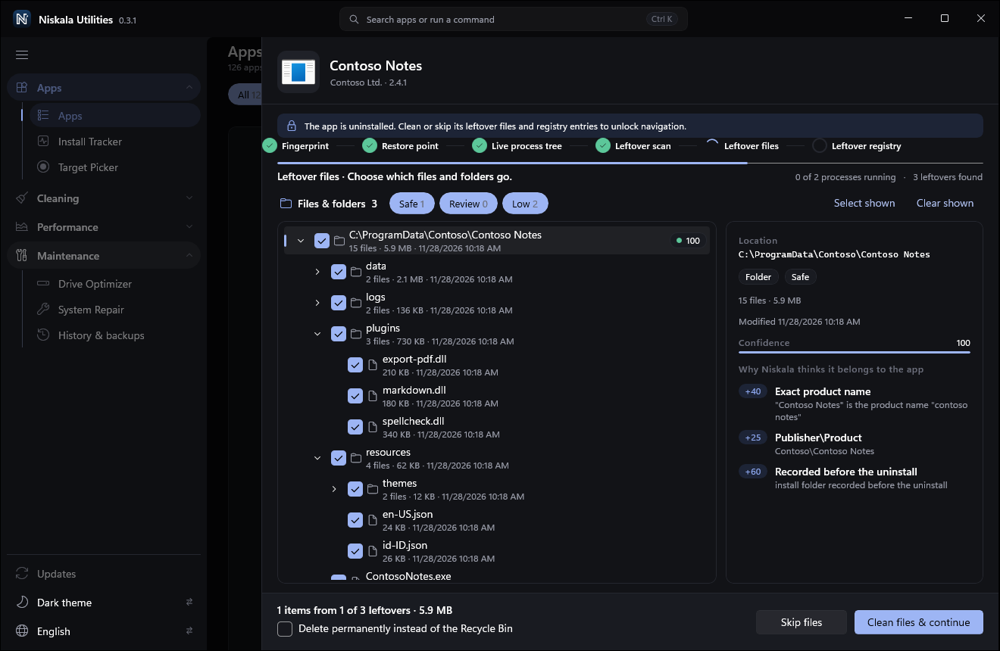
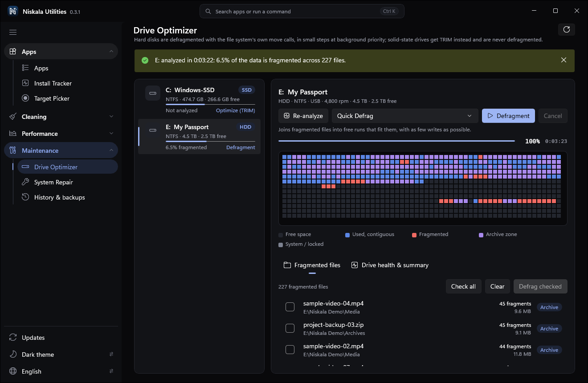
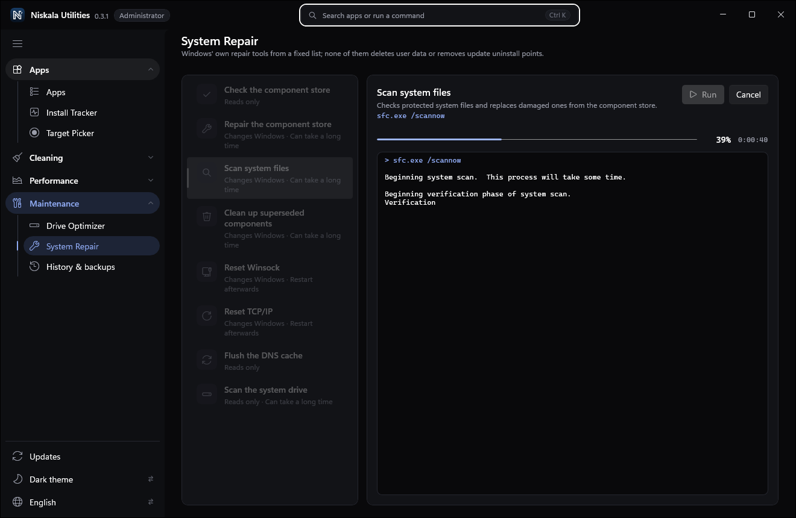
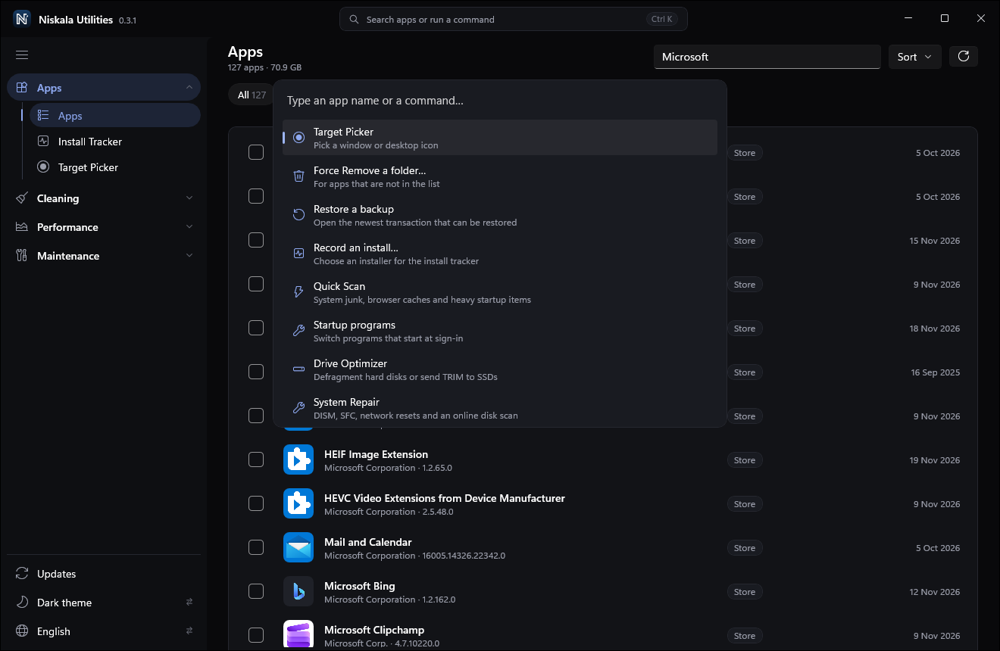

<div align="center">


# Niskala Utilities

**Complete Windows uninstaller, system cleaner, drive optimizer and non-destructive repair suite.**<br>
**Built in Native AOT. Free, forever.**

[**Download the latest release**](https://github.com/Adriansyah101/NiskalaUtilities/releases/latest) · [**Patch notes**](PATCHNOTES.md) · [**Star Niskala Utilities on GitHub**](https://github.com/Adriansyah101/NiskalaUtilities)

Windows 10 and 11 (x64, ARM64) · English & Bahasa Indonesia · Dark & Light Theme · Zero Ads, Zero Telemetry, Free Forever

<br>

| `Native AOT` | `6-Stage Removal` | `HDD + SSD` | `100% Free` |
|:---:|:---:|:---:|:---:|
| Pure machine code for `win-x64` and `win-arm64`. A Direct2D splash and an instant start, with no heavy runtime to load. | Fingerprint, restore point, live process tree, leftover scan, then leftover files and registry reviewed one by one. Kernel ETW install tracing for an exact rollback. | Real hardware detection, even behind USB bridges: speed-zone defragmentation on hard disks, safe TRIM on SSDs without moving a single block. | GNU GPL-3.0. No ads, no subscription, no data collection, and a full rollback from the transaction journal. |

<br>



<sub>The Apps page in the dark theme: every installed program with its icon, size and an inspector one click away.</sub>

<br><br>

[](https://github.com/Adriansyah101/NiskalaUtilities/releases/latest)
[](LICENSE)
[](#build--release-from-source)
[](#build--release-from-source)
[](https://github.com/Adriansyah101/NiskalaUtilities/releases)

**[Download](#download)** · **[Why Niskala](#why-niskala-utilities)** · **[Screenshots](#screenshots)** · **[Features](#features)** · **[Architecture](#security--architecture)** · **[Build](#build--release-from-source)**

</div>

<br>

## Download

<div align="center">

### [Get Niskala Utilities from the latest release](https://github.com/Adriansyah101/NiskalaUtilities/releases/latest)

</div>

| File | What it is |
|---|---|
| `NiskalaUtilities-Setup-v0.3.4-win-x64.exe` | The official installer for 64-bit Windows 10 and 11 PCs (Intel / AMD), with a Start menu shortcut and an optional desktop shortcut. |
| `SHA256SUMS.txt` | The SHA-256 checksum of the installer, to verify that your download is the published file. |

Compare the hash with the line in `SHA256SUMS.txt`:

```powershell
(Get-FileHash .\NiskalaUtilities-Setup-v0.3.4-win-x64.exe -Algorithm SHA256).Hash
```

> [!NOTE]
> **"Windows protected your PC"?** The installer is signed with the project's own certificate
> (`CN=Niskala Project`), not a commercial one, so SmartScreen does not know it yet. Check the hash,
> then choose **More info** → **Run anyway**.
>
> **Updates come to you.** When a newer release is out, Niskala says so when it opens (you can turn
> this off), then downloads it, verifies its checksum and installs it in place.

## Why Niskala Utilities?

| | **Niskala Utilities** | **Built-in Windows tools** | **Proprietary commercial utilities** |
|---|---|---|---|
| **Uninstall & leftover cleanup** | Six steps: fingerprint, restore point, live process tree, leftover scan, leftover files, leftover registry. Kernel ETW install tracking gives an exact rollback, and every removal is journaled and can be restored. | Runs the program's own uninstaller; the folders, keys, services and tasks it leaves behind stay. | Leftover scans are common; install tracing and a per-item undo vary by product and edition. |
| **Drive optimization** | Opens at once and tells hard disks from SSDs per drive in the background, also behind USB bridges. A drive table rates each drive, a Strategy Guide drawer applies the right mode, the cluster map marks MFT reserved areas and compressed files, S.M.A.R.T. is read through SAT and NVMe USB bridges, and a Task Scheduler plan keeps drives tidy. TRIM only on SSDs, never a cluster move. | Optimize Drives defragments hard disks and retrims SSDs on a schedule, without a file list or cluster map. | Cluster maps are common; how SSDs are handled differs from tool to tool. |
| **System repair** | `DISM`, `SFC`, Winsock and IP reset, DNS flush and `CHKDSK /scan` from a closed, safe list that never adds a destructive switch, with a local `.wim` / `.esd` repair source, live progress and explained error codes. | The same tools, typed by hand in an elevated console, with raw output. | Varies by product; the commands behind a fix button are not always shown. |
| **Architecture & footprint** | Native AOT machine code in one installer. No background service, tray agent, scheduled task or startup entry: nothing runs while the app is closed. | Part of Windows. | Often a resident tray agent or background service for monitoring and updates. |
| **Price, ads & telemetry** | Free forever, open source under GPL-3.0. No ads, no account, no telemetry; the only network request is the GitHub release check, which you can turn off. | Included with Windows; diagnostic data follows the Windows privacy settings. | Usually a free tier with upsells or a subscription; data collection depends on the vendor. |

## In Your Language

Niskala Utilities speaks **English** and **Bahasa Indonesia**, completely: every page, dialog,
button, banner and System Repair explanation. Switch with one click on the language button at the
bottom left of the sidebar; the theme button next to it switches between the **Dark** and the
**Light** theme just as fast, and both choices are remembered.

## Screenshots

| | |
|:---:|:---:|
| <br>**Dark theme** | <br>**Light theme** |
| <br>**6-stage uninstaller & leftover review** | <br>**Drive Optimizer** |
| <br>**System Repair** | <br>**Command palette (`Ctrl+K`)** |

## Features

| Module | What it does for you |
|---|---|
| **Apps & Uninstaller** | Every desktop program and Store app in one list with icons, sizes and filters. Uninstall in six steps with a leftover review, plus Force Remove, Batch Remove and direct removal of Steam games. |
| **Install Tracker** | Records an installer with a kernel trace of its process tree, so uninstalling later rolls back exactly what it created and changed. |
| **Target Picker** | Point at a window, desktop icon or tray icon to name the program behind it, then uninstall it, stop it, disable it at startup or open its folder. |
| **Quick Scan & Selective Clean** | One scan for system junk, browser caches and heavy startup items, or exactly the rules you pick. Open browsers are left alone and a restore point comes first. |
| **Registry Integrity** | Finds file types, shared files, COM classes, firewall rules and services that point at missing programs, and repairs them with a backup. |
| **Resource Control** | Startup entries, third-party services, scheduled tasks and context-menu handlers with a boot-impact estimate and one switch each. |
| **Process Suspend** | Freezes, throttles with efficiency mode or caps the CPU of idle background programs, and resumes them even after a restart of Niskala. |
| **Drive Optimizer** | Defragments hard disks with speed zones and a clickable cluster map, recommends a strategy per drive, reads S.M.A.R.T. health also through USB bridges, queues several drives, runs on a weekly, monthly or idle schedule and sends only TRIM to SSDs. |
| **System Repair** | Windows' own repair tools from a fixed, safe list, with live progress, a console-like log and plain explanations of failures. |
| **History & Backups** | Every removal, clean, registry repair and switch is a journaled transaction; restore what can come back with one click. |
| **Updates** | Checks GitHub for a new release, verifies its SHA-256 checksum and installs it in place. |

## Security & Architecture

Niskala Utilities is written in **C# on .NET 10**, compiled with **Native AOT** into machine code,
with a **WinUI 3** interface and two small C++20 parts: the launcher with its Direct2D splash and
the ETW helper of the Install Tracker. It is a clean-room implementation: no code or binaries of
other uninstallers or system utilities were analysed or reused. Every removal passes two guards,
**`PathGuard`** for files and folders and **`RegistryGuard`** for keys and values, once when the
scan proposes it and again right before it happens, so Windows folders, protected hives and
Niskala's own files stay out of reach. Each change is first recorded in a transaction journal, with
a backup of the registry entries it touches and, where Windows allows it, a restore point, and
**History & backups** restores it with one click. Nothing stays behind in the background: no service, tray agent, scheduled task or
startup entry, and the only network request is the optional GitHub release check.

| Path | Contents |
|---|---|
| `src/*` | The C# projects: interop, core and safety layer, inventory and leftover scanner, uninstaller, Guardian journal, Install Tracker, cleaner, optimizer, repair, updater, host and the WinUI 3 app. |
| `native/*` | `Niskala.Launcher` (release entry point and splash) and `Niskala.EtwHelper` (real-time ETW session), C++20 with MSVC v143. |
| `rules/*` | The declarative JSON cleaning rules, shipped in `lib\rules\`. |
| `installer/*` | The Inno Setup script for `NiskalaUtilities-Setup-v<version>-<rid>.exe`. |
| `tests/*` | xunit v3 tests on Microsoft.Testing.Platform, run against scratch folders, scratch registry keys and an in-memory disk. |
| `scripts/*` | `Build-Release.ps1` for the release and `New-AppIcon.ps1` for the icon. |

## Build & Release from Source

You need:

- the **.NET 10 SDK**;
- **Visual Studio 2022 Build Tools** with the **Desktop development with C++** workload
  (`MSVC v143` and the Windows SDK; add the ARM64 tools for `win-arm64`);
- **Inno Setup** 6 or 7 for the installer (`winget install --id JRSoftware.InnoSetup -e`).

```powershell
dotnet build Niskala.sln
dotnet test --solution Niskala.sln
powershell -ExecutionPolicy Bypass -File scripts\Build-Release.ps1 [-Runtime win-x64|win-arm64]
```

The release script runs the tests, publishes the app with Native AOT and writes the installer and
`SHA256SUMS.txt` to `artifacts\release`. The version comes from `Directory.Build.props`. A few
tests need elevation and are skipped from a normal prompt.

## License

Copyright (c) 2026 Niskala Project

Niskala Utilities is free software: you can redistribute it and/or modify it under the terms of
the GNU General Public License as published by the Free Software Foundation, version 3
(`GPL-3.0-only`). The full text is in [LICENSE](LICENSE); every release package carries a copy
in `lib\LICENSE`.

Niskala Utilities is distributed in the hope that it will be useful, but it is provided "AS IS",
WITHOUT ANY WARRANTY; without even the implied warranty of MERCHANTABILITY or FITNESS FOR A
PARTICULAR PURPOSE. See sections 15 and 16 of the license for the full disclaimer of warranty and
limitation of liability.
